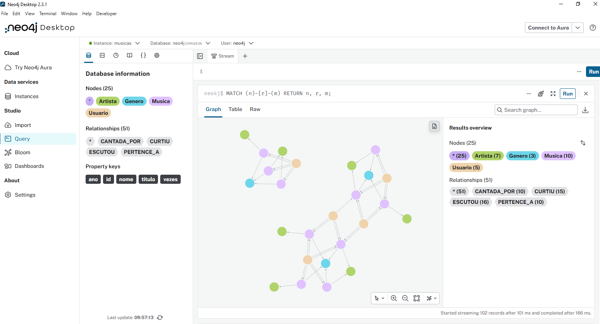
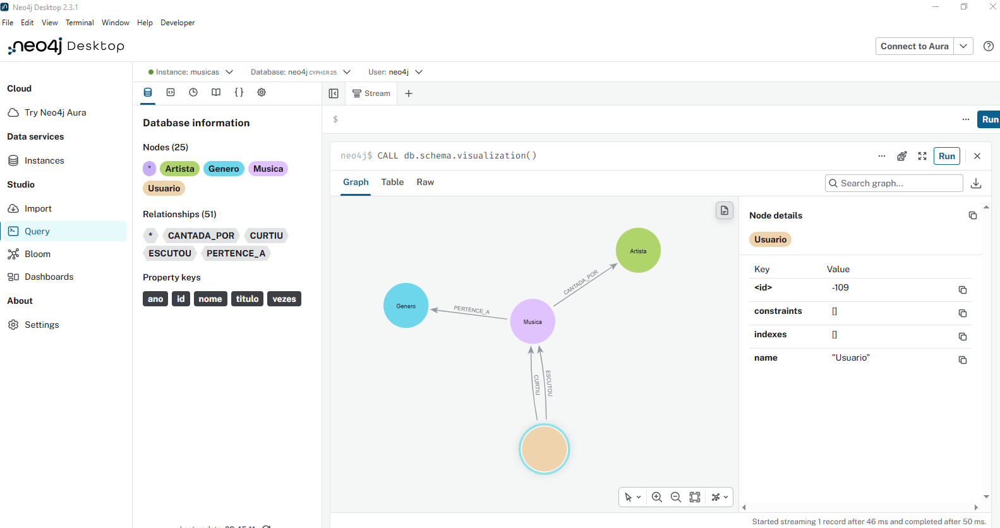
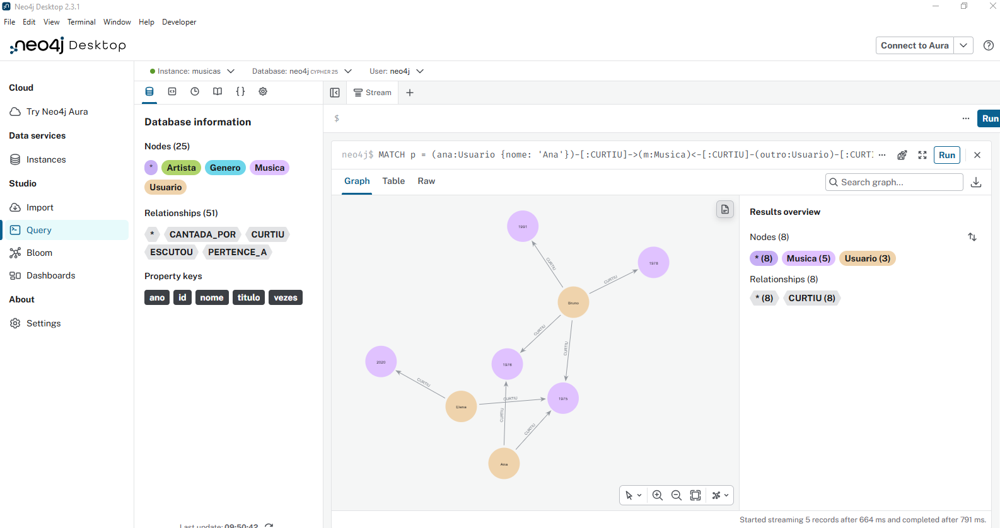
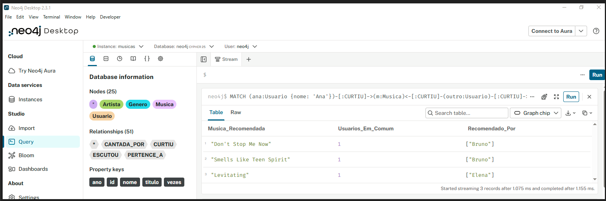
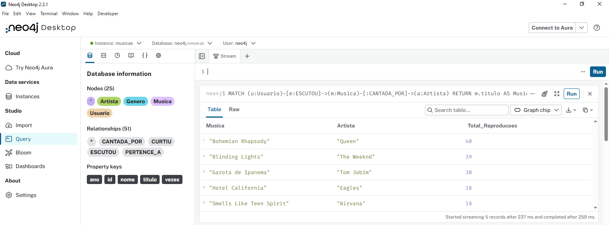

# Algoritmo de Recomendação de Músicas com Neo4j

Projeto desenvolvido para o desafio prático da **DIO**, com foco em modelagem de banco de dados em grafos e criação de consultas de recomendação utilizando **Neo4j** e **Cypher**.

## Contexto do Problema e Por Que Usar Grafos?

Sistemas de recomendação tradicionais em bancos relacionais (SQL) exigem múltiplos `JOINs` custosos para cruzar usuários, histórico de reprodução, curtidas, artistas e gêneros. Em um banco de dados orientado a grafos como o **Neo4j**, os relacionamentos são armazenados nativamente, permitindo percorrer conexões complexas (como _filtragem colaborativa_) em milissegundos e com consultas muito mais legíveis.

## Visão do Banco Populado

O banco foi modelado com **4 Labels de Nós** (`Usuario`, `Musica`, `Artista`, `Genero`) e **4 Tipos de Relacionamentos** (`ESCUTOU`, `CURTIU`, `CANTADA_POR`, `PERTENCE_A`).

### Visão do Banco 

## Estrutura do Repositório

    ├── data/
    │   ├── usuarios.csv
    │   ├── musicas.csv
    │   └── interacoes.csv
    ├── images/
    │   ├── banco_populado.png
    │   ├── esquema_grafo.png
    │   ├── ranking_populares.png
    │   ├── recomendacao_genero.png
    │   ├── recomendacao_grafo.png
    │   └── recomendacao_tabela.png
    ├── scripts/
    │   ├── carga_dados.cypher
    │   └── queries_recomendacao.cypher
    └── README.md

## Como Executar o Projeto

1. Crie e inicie uma instância local no **Neo4j Desktop** (ou AuraDB).
2. Copie os 3 arquivos da pasta `data/` para a pasta `import` da sua instância no Neo4j.
3. Abra o editor **Query** no Neo4j e execute os blocos do arquivo `scripts/carga_dados.cypher`.
4. Execute as consultas do arquivo `scripts/queries_recomendacao.cypher` para visualizar os resultados.

## Queries de Negócio e Evidências Visuais

### 1. Filtragem Colaborativa (Recomendação por Usuários Similares)

_Pergunta:_ Quais músicas recomendar para a usuária **Ana** com base no que outros usuários com gostos em comum curtiram, mas que ela ainda não ouviu?

**Visualização em Grafo:**

### 2. Recomendação por Gênero Favorito

_Pergunta:_ Quais faixas pertencem aos mesmos gêneros que a Ana já curtiu e que ainda não estão no seu histórico?

### 3. Ranking de Popularidade

_Pergunta:_ Quais são as 5 músicas mais reproduzidas na plataforma somando todos os usuários?

## Troubleshooting (Dificuldades e Soluções)

<<<<<<< HEAD

- **Erro `22N43: Data exception - unable to load external resource`:** Ao rodar o comando `LOAD CSV`, se Neo4j não encontrar os arquivos `.csv`. **Solução:** O Neo4j restringe a leitura local por segurança à subpasta `import` interna da instância ativa. Copie os arquivos de `data/` para o diretório `import` da instância, a carga será concluída com sucesso (25 nós e 51 relacionamentos).
